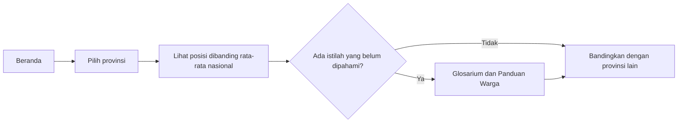
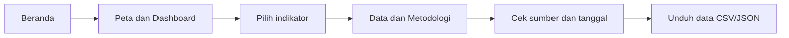
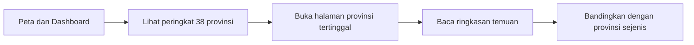

# Peta Kopdes Merah Putih

> Website open data yang mengubah angka Koperasi Desa/Kelurahan Merah Putih (KDKMP) menjadi gambaran yang mudah dipahami warga: provinsimu sudah sampai di mana?

**Kompetisi:** Web In Action, Multimedia In Action 2026
**Subtema:** Open Government Data
**Tim:** `Pedede` · `Mukhamad Badrus Sholeh, Rezky Mufidah Hidayat, dan Fika Qurrata 'Ayuni`
**Status:** First Draft 

---

## 1. Latar belakang dan masalah

Pemerintah menargetkan puluhan ribu KDKMP beroperasi sebagai infrastruktur ekonomi di tingkat desa. Datanya sudah tersedia di dashboard Simkopdes, tetapi bagi warga awam ada tiga masalah:

1. **Data sulit dibaca.** Angka mentah per provinsi tidak langsung menjawab pertanyaan warga: "Bagaimana koperasi di wilayahku?"
2. **Tahapan koperasi sering tercampur.** Koperasi yang terbentuk, berizin usaha (NIB), sudah rapat anggota (RAT), sudah punya gerai, dan sudah bertransaksi adalah hal yang berbeda, tetapi sering dibicarakan seolah sama.
3. **Kesenjangan antarwilayah tidak terlihat.** Dari data yang dipakai, provinsi di Jawa dan di Papua berada pada kondisi yang sangat berbeda, dan itu sulit disadari tanpa perbandingan.

## 2. Tujuan dan manfaat

**Tujuan:** menyajikan data resmi KDKMP secara visual, sederhana, dan dapat dibandingkan antarprovinsi.

**Manfaat:**
- **Warga:** memahami kondisi koperasi di provinsinya dengan bahasa sehari-hari.
- **Pengurus dan pendamping koperasi:** melihat posisi wilayah dibanding rata-rata nasional.
- **Pemerintah daerah dan pembuat kebijakan:** menemukan wilayah yang tertinggal pada tahap tertentu.
- **Jurnalis dan peneliti:** mengakses data yang sudah dirapikan beserta sumbernya.

## 3. Solusi dan fitur

| Fitur | Deskripsi | Status |
|---|---|---|
| Pembanding provinsi | Pilih provinsi, lihat NIB, NPWP, RAT, gerai, dan pemetaan lahan dibanding rata-rata nasional | Selesai (prototipe) |
| Temuan utama otomatis | Ringkasan wilayah terendah dan tertinggi, dihitung dari data | Selesai (prototipe) |
| Grafik 38 provinsi | Urutan provinsi berdasarkan indikator pilihan | Selesai (prototipe) |
| Tabel data lengkap | Dapat diurutkan per kolom | Selesai (prototipe) |
| Peta Indonesia interaktif | Provinsi diwarnai sesuai indikator | Rencana |
| Skor kesiapan koperasi | Gabungan indikator dengan bobot dan cara hitung yang transparan | Rencana |
| Bandingkan dua provinsi | Tampilan berdampingan | Rencana |
| Halaman Data dan Metodologi | Sumber, tanggal, definisi indikator, unduh data | Rencana |
| Glosarium | Penjelasan NIB, NPWP, RAT, SHU dalam bahasa awam | Rencana |
| Panduan Warga | Apa itu KDKMP, cara menjadi anggota, dan tautan ke kanal resmi (halaman statis, tanpa login) | Rencana |

**Pembeda dari dashboard resmi:** dashboard Simkopdes menampilkan data, sedangkan Peta Kopdes menjelaskan artinya. Fokusnya perbandingan, konteks, dan bahasa yang bisa dipahami warga.

## 4. Sitemap

```
Beranda
├── Peta dan Dashboard
│   ├── Peta sebaran per indikator
│   └── Peringkat 38 provinsi
├── Halaman Provinsi (ringkasan dalam kalimat sederhana)
├── Bandingkan Provinsi
├── Data dan Metodologi
│   ├── Sumber dan tanggal data
│   ├── Definisi indikator
│   └── Unduh data (CSV/JSON)
├── Panduan Warga
└── Glosarium
```

## 5. Alur pengguna (user flow)

Website ini sengaja tanpa login dan tanpa katalog. Semua orang bisa langsung memakai datanya.

**Warga awam: ingin tahu kondisi koperasi di provinsinya**



**Jurnalis atau peneliti: butuh data yang bisa dikutip**



**Pembuat kebijakan atau pendamping koperasi: mencari wilayah yang perlu perhatian**



**Kebutuhan koperasi dan warga yang dilayani tanpa login:** halaman Panduan Warga memuat penjelasan program dan tautan ke kanal resmi (misalnya dashboard Simkopdes), sehingga pengurus dan calon anggota tahu ke mana harus pergi untuk layanan yang sifatnya transaksional.

## 6. Data

**Sumber:** Simkopdes, https://simkopdes.go.id/pers/dashboard
**Tanggal pengambilan:** `[isi tanggal]` (belum dicantumkan di file data)
**Cakupan:** 38 provinsi

| Indikator | Keterangan |
|---|---|
| `jumlah_koperasi` | Jumlah KDKMP yang tercatat |
| `nib`, `npwp` | Jumlah koperasi yang memiliki NIB dan NPWP |
| `rat_2025` | Jumlah koperasi yang sudah melaksanakan RAT 2025 |
| `simpanan_pokok`, `simpanan_wajib` | Total simpanan (Rp) |
| `volume_transaksi_2026`, `nilai_transaksi_2026` | Jumlah dan nilai transaksi tahun 2026 |
| `pemetaan_lahan`, `pemetaan_lahan_pct` | Jumlah dan persentase koperasi dengan lahan terpetakan |
| `pembangunan_gerai_pct` | Persentase progres pembangunan gerai |

Kolom `nib_pct`, `npwp_pct`, dan `rat_pct` dihitung dari data di atas.

**Catatan kualitas data:**
- Persentase pemetaan lahan mengikuti angka sumber dan tidak selalu sama dengan jumlah lahan dibagi jumlah koperasi.
- Volume transaksi Jawa Barat, Jawa Tengah, dan Jawa Timur berisi desimal di sumber.
- Data hanya sampai tingkat provinsi.
- Data diolah ulang untuk tampilan ini dan bukan publikasi resmi pemerintah.

## 7. Tech stack

- HTML, CSS, dan JavaScript (tanpa framework)
- Font: Bricolage Grotesque (Google Fonts)
- Data: berkas JSON dan CSV statis
- Rencana: Leaflet atau SVG peta Indonesia untuk visualisasi peta

## 8. Cara menjalankan

```bash
# 1. Clone repositori
git clone <url-repositori>
cd <nama-folder>

# 2. Tidak perlu instalasi paket
# 3. Jalankan: buka index.html di browser,
#    atau gunakan server lokal:
python3 -m http.server 8000
# lalu buka http://localhost:8000
```

## 9. Struktur berkas

```
.
├── index.html                 # Halaman utama (prototipe)
├── data.json                  # Data bersih beserta metadata sumber
├── data_kopdes_bersih.csv     # Data yang sama dalam format CSV
└── README.md
```

## 10. Progress saat ini

- [x] Pembersihan dan validasi data 38 provinsi
- [x] Prototipe halaman tunggal: pembanding provinsi, temuan utama, grafik, tabel
- [ ] Pemisahan menjadi beberapa halaman (Beranda, Dashboard, Data, Glosarium)
- [ ] Peta interaktif dan skor kesiapan
- [ ] Halaman provinsi dan fitur bandingkan
- [ ] Pengujian di HP dan beberapa browser

## 11. Rencana pengembangan

1. **Tingkat kabupaten/kota** untuk fitur "Cek Wilayahku", bila data tersedia atau melalui permintaan informasi publik ke PPID Kementerian Koperasi.
2. **Pembaruan data berkala** dengan riwayat per tanggal, sehingga perkembangan bisa dilihat dari waktu ke waktu.
3. **Notifikasi dan berbagi** ringkasan provinsi lewat WhatsApp.
4. **Mode hemat data** untuk wilayah dengan sinyal terbatas.
5. **Akun pengurus koperasi** (login) untuk memperbarui profil dan data koperasi, dengan verifikasi.
6. **Etalase produk desa** (katalog) yang terhubung ke koperasi terverifikasi.
7. **Pelacakan layanan** (status pendaftaran anggota atau pengajuan) jika ada kerja sama dengan pengelola data.

## 12. Keterbatasan

- Data bersifat snapshot, bukan real-time.
- Belum ada data tingkat kabupaten.
- Tidak ada login, katalog, atau transaksi pada versi ini. Ini keputusan desain agar fokus pada data terbuka; fitur tersebut ada di rencana pengembangan.
- Skor kesiapan (rencana) bergantung pada pilihan bobot yang akan dijelaskan secara terbuka.

## 13. Lisensi dan atribusi

Data bersumber dari Simkopdes. Kode dan desain dibuat oleh tim `Pedede` untuk Web In Action, Multimedia In Action 2026.
